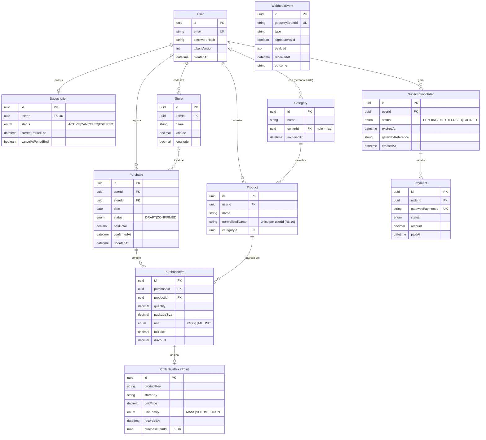

# 🛠️ Architecture / Software Design Document

**Projeto:** Pyla — controle de gastos de mercado com comparação colaborativa de preços
**Versão:** 1.1.0 · gerado via `/utf-architecture`, ratificado no `/utf-setup`
**Última atualização:** 2026-10-13

> 🤖 **O `prd.md` responde _o quê_ o produto faz. Este responde _onde as coisas
> moram e como se chamam_.** Detalhe de tela — rota, componente, contrato —
> **não** se decide aqui: isso é trabalho da spec de cada história.
>
> ✍️ **Não preencha na mão:** mudanças passam por `/utf-architecture` ou por uma
> Issue de manutenção. Versões abaixo foram conferidas na documentação oficial
> (Context7) em 2026-10-10.

---

## 🤖 1. Fontes de Contexto para a IA

> Onde a IDE agêntica busca a verdade. **Isto é o índice; a configuração mora
> nos arquivos** — documento não configura ferramenta.

| Fonte | Onde configurar | Serve para |
| :---- | :-------------- | :--------- |
| Constituição da IA | `.agents/rules/utf-rules.md` (via `CLAUDE.md`) | Regras inegociáveis: fases do SDD, 2 rodadas, revisores distintos, Git |
| Fluxos da IA | `.agents/workflows/` | PRD, backlog, jornadas e tokens, architecture, setup, ciclo por Issue, ciclo por tarefa, tutor |
| Agentes (subagentes) | `.agents/agents/` (cascas em `.claude/`, `.cursor/` e `.opencode/`) | Implementador, revisores, auditor final e tutor |
| Ficha da disciplina | `docs/checklist.md` | Regras do projeto, IDs e entregas |
| Design (Stitch) | [protótipo](https://stitch.withgoogle.com/preview/14093580883373874346?node-id=494ddf8c28484334bdcaefcc21961c93) · `docs/design-tokens.md` | Cores, tipografia, hierarquia visual |

---

## 📦 2. Stack Tecnológica

> Definição **estrita**: nenhuma dependência entra sem aparecer aqui. Esta
> seção e o `package.json` de cada app contam a mesma história. Versão = linha
> *major*; o pin exato vive no `package.json`.

**Runtime:** Node.js **24**, fixado no setup em `.nvmrc` e no `engines`
(`>=24`) da raiz e dos dois apps · TypeScript **6** nos dois apps.

### Backend — `apps/api` (fixado pela ficha)

| Peça | Escolha | Observação |
| :--- | :--- | :--- |
| Framework | **NestJS 12** | Projeto **ESM** (padrão do `nest new` na v12) |
| ORM | **Prisma ORM 7** | `prisma.config.ts`, gerador `prisma-client`, adaptador `@prisma/adapter-pg`. O Prisma 8 é *release candidate* e não tem escrita aninhada nem os códigos `P2002`; não usar |
| Banco | **PostgreSQL 18** | A mesma major no local, no CI e em produção |
| Validação | `class-validator` + `class-transformer` | Exigidos pelo `ValidationPipe` (ID7) |
| Configuração | `@nestjs/config` | `ConfigModule` com validação das variáveis no boot (ID17) |
| Autenticação | `@nestjs/jwt` | JWT em cookie `httpOnly` (ID9, ID16) |
| Hash de senha | `bcrypt` | |
| Documentação | `@nestjs/swagger` | Contrato vivo (§2.2, ID14) |
| Agendamento | `@nestjs/schedule` | Jobs de expiração e reconciliação (§5.4) |
| Pagamento | Mercado Pago, **sandbox** | Cliente (SDK oficial ou HTTP direto) é decidido na spec da US06 |

### Frontend — `apps/web` (escolha do aluno)

| Peça | Escolha | Observação |
| :--- | :--- | :--- |
| Biblioteca | **React 19** | |
| Build | **Vite 8** | Template `react-ts`. SPA: não há servidor próprio do front |
| Roteamento | **React Router** | Lazy loading por rota de feature |
| Estado do servidor | **Hooks próprios sobre `fetch`** | Sem biblioteca de cache; os hooks vivem em `features/*/api` |
| Estilo | **Tailwind CSS** + `@tailwindcss/vite` | Os tokens de `design-tokens.md` entram em `@theme` com o nome semântico (`--color-primaria` → `bg-primaria`) |

### Padrões de código do frontend (ratificados)

1. Componentes de função com hooks, sem classes.
2. Estado do servidor separado do estado de UI.
3. Roteamento com lazy loading por rota de feature.
4. Componentes de página distintos de componentes reutilizáveis.
5. **Regra da camada de dados:** componente não fala com o servidor. Todo
   acesso à API passa por `features/<feature>/api/`, que usa o cliente HTTP de
   `shared/`. Mudança de contrato mexe só nessa camada, nunca nas telas.

### Testes e lint

| App | Teste | Lint | Comandos (rodar dentro da pasta do app) |
| :--- | :--- | :--- | :--- |
| `apps/api` | **Vitest** (unit) + Vitest e2e com `supertest` | **oxlint** | `npm test` → `vitest run` · `npm run test:e2e` → `vitest run --config ./vitest.config.e2e.ts` · `npm run lint` → `oxlint` |
| `apps/web` | **Vitest** + `@testing-library/react` + `@testing-library/jest-dom` em **jsdom** | **oxlint** | `npm test` → `vitest run` · `npm run lint` → `oxlint` |

> O template `react-ts` do Vite **não** traz script de teste: o setup adiciona
> `test` ao `package.json` do web.

### 🧱 2.1. Backend — regras estruturais

> **Esta seção é o critério fixo do `revisor-codigo`.** Cada regra cita o ID da
> ficha que a cobra.

**Camadas (ID6, ID8)**
- Um módulo por domínio. Dentro dele, o fluxo é
  `controller → service → repository → PrismaService`, sempre nessa ordem.
- **Controller** recebe o DTO, chama o service e devolve o resultado. Não tem
  regra de negócio e não toca o Prisma.
- **Service** guarda a regra de negócio. Não importa o Prisma Client; fala com
  o repository.
- **Repository** é o único lugar que chama o `PrismaService`.
- Um módulo de domínio só usa outro pelo service que esse outro exporta, nunca
  pelo repository nem por arquivo interno.
- Escrita que toca várias tabelas usa `prisma.$transaction`. Exemplos:
  confirmar a compra com seus itens e pontos da base coletiva; processar o
  webhook com o pedido, o pagamento e a assinatura.

**Entrada da API (ID7)**
- `ValidationPipe` **global** em `main.ts` com
  `{ whitelist: true, forbidNonWhitelisted: true, transform: true }`.
- Todo corpo, query e parâmetro de rota tem DTO em `<dominio>/dto/`.
- Requisição malformada é recusada antes do service, sem efeito colateral.

**Autenticação e acesso (ID9)**
- O login emite um JWT (`@nestjs/jwt`) num cookie `httpOnly`, `Secure` e
  `SameSite`. O JavaScript do front nunca lê o token.
- O JWT carrega `sub` (id do usuário) e `tokenVersion`. O logout incrementa
  `User.tokenVersion`, e o guard recusa token de versão antiga (US01).
- `JwtAuthGuard` é **global** (`APP_GUARD`). Rotas abertas são marcadas
  explicitamente com `@Public()`: cadastro, login, webhook do gateway e a
  documentação.
- `PremiumGuard` + `@RequiresPremium()` protegem os recursos premium (RN14).
  Premium é **derivado** da `Subscription` (§5.1), nunca uma coluna de papel.
- Os limites de período do usuário gratuito (só o mês corrente) são regra de
  **service**, não de guard. A rota é a mesma; o que muda é o recorte.
- **Propriedade do dado (RN21):** todo método de repository que lê ou escreve
  dado privado recebe o `userId` do token e filtra por ele. Recurso de outro
  usuário é tratado como inexistente. Nenhuma rota aceita `userId` vindo do
  cliente.

**Formato de resposta e de erro (ID10)**
- Um **interceptor global** envolve toda resposta de sucesso em `{ "data": … }`.
- Um **exception filter global** converte todo erro em
  `{ "statusCode", "error", "message", "details"?, "path", "timestamp" }`.
  `details` lista campo por campo nos erros de validação.
- `message` vem em **português** (NFR de idioma). Stack trace e erro do Prisma
  nunca saem na resposta.
- Erros conhecidos do Prisma (ex.: `P2002`, unicidade) são traduzidos pelo
  filtro para 4xx. Exceção não prevista vira 500 genérico.

**Segredos e configuração (ID17, RN20)**
- `ConfigModule` global valida no boot que as variáveis obrigatórias existem.
  Se faltar alguma, a API não sobe.
- As variáveis são `DATABASE_URL` (pooled), `DIRECT_URL` (direta, só para o
  CLI do Prisma), `JWT_SECRET`, `MP_ACCESS_TOKEN`, `MP_WEBHOOK_SECRET` e
  `WEB_ORIGIN`. Os nomes finais são confirmados no setup.
- `.env` está no `.gitignore`. O repositório só tem `.env.example`, com nomes
  e sem valores.
- Em produção, as variáveis vivem só no painel do Render; no CI, só nos
  *secrets* do GitHub.
- CORS aceita apenas `WEB_ORIGIN`, com `credentials: true` (o cookie cruza
  origem).

**Pagamento e webhook (ID20, ID21)**
- O pedido (`SubscriptionOrder`) é **criado no servidor** antes de ir ao
  gateway. O front nunca fala com o Mercado Pago com credencial.
- O webhook é `@Public()` e valida o `x-signature` (HMAC-SHA256 sobre
  `id:{data.id};request-id:{x-request-id};ts:{ts};` com `MP_WEBHOOK_SECRET`)
  antes de qualquer leitura de estado.
- Todo evento recebido é gravado em `WebhookEvent`, inclusive os de assinatura
  inválida ou de pedido desconhecido.
- **Idempotência (RN18):** `gatewayEventId` é único. Evento repetido é
  registrado e não produz efeito.
- O endpoint responde 2xx para evento ignorado de forma segura. Ele nunca cai
  por pedido desconhecido.

### 🌐 2.2. O contrato da API

- **Documentação viva:** `@nestjs/swagger` com
  `SwaggerModule.setup('docs', …)`. A interface interativa fica em `/docs` e o
  JSON em `/docs-json`. Rotas autenticadas declaram `@ApiCookieAuth()`.
- O Swagger é **gerado do código** pelos decorators dos DTOs e controllers.
  O arquivo gerado (`swagger.json`) **não é commitado**: a fonte é o endpoint
  vivo.
- A camada `features/*/api` do front escreve seus tipos a partir de
  `/docs-json`. Adotar um gerador automático de tipos é dependência nova e
  exige registro aqui.
- Este documento **não mantém tabela de endpoints**.

---

## 🗂️ 3. Estrutura do Repositório (Monorepo)

> Uma pasta por aplicação, cada uma com o seu `package.json`. Sem npm
> workspaces, Nx ou Turborepo enquanto não houver código compartilhado de
> verdade.

```text
.
├── .agents/               # constituição, workflows e prompts dos agentes (§1)
├── .claude/ .cursor/ .opencode/   # cascas de cada ferramenta — só apontam para .agents/
├── .github/               # template de PR, Portão de Entendimento, workflows de CI
├── CLAUDE.md  AGENTS.md   # carregam a constituição em toda sessão
├── README.md              # a vitrine: o que é e como rodar
├── docker-compose.yml     # postgres:18 para desenvolvimento local
├── docs/                  # prd.md, user-flows.md, design-tokens.md, este arquivo, checklist.md e guias
├── specs/                 # uma pasta por história implementada
└── apps/
    ├── api/                          # NestJS 12 · Prisma 7
    │   ├── prisma/                   # schema.prisma, migrations/
    │   ├── prisma.config.ts          # URL direta (migrations) fora do schema
    │   ├── src/
    │   │   ├── main.ts               # bootstrap: ValidationPipe, Swagger, CORS, filtro e interceptor
    │   │   ├── app.module.ts
    │   │   ├── config/               # ConfigModule + validação das variáveis de ambiente
    │   │   ├── prisma/               # PrismaModule + PrismaService (único ponto do client)
    │   │   ├── common/               # guards, interceptors, exception filters, decorators
    │   │   └── <dominio>/            # um módulo por domínio (ver §6)
    │   │       ├── <dominio>.module.ts
    │   │       ├── <dominio>.controller.ts
    │   │       ├── <dominio>.service.ts
    │   │       ├── <dominio>.repository.ts
    │   │       └── dto/
    │   └── test/                     # e2e (vitest.config.e2e.ts)
    └── web/                          # React 19 · Vite 8 · React Router · Tailwind
        └── src/
            ├── main.tsx · app/       # roteamento, layout, tema (@theme com os tokens)
            ├── features/<feature>/   # uma pasta por área do produto
            │   ├── pages/            # componentes de página (ligados a rota)
            │   ├── components/       # reutilizáveis só desta feature
            │   └── api/              # repositório + hooks — ÚNICO que fala com a API
            └── shared/               # componentes reutilizáveis, cliente HTTP, utilitários
```

Testes ficam ao lado do arquivo testado (`*.spec.ts` na api, `*.test.tsx` no
web). Os e2e da api ficam em `apps/api/test/`.

**Decisões do setup (ratificadas em 2026-10-13):**
- **Scripts da raiz:** `test` e `lint` rodam api e web em sequência
  (`npm --prefix`); `dev:api` e `dev:web` sobem cada app. A raiz não tem
  dependências.
- **Client do Prisma:** gerado em `apps/api/src/generated/prisma`, fora do
  Git. O `postinstall` da api roda `prisma generate` a cada instalação.
- **`.env` no CLI do Prisma:** o `prisma.config.ts` carrega o `.env` com
  `import 'dotenv/config'` (ficha da Atividade 08). Na aplicação, quem lê o
  `.env` é o `ConfigModule.forRoot({ isGlobal: true })` do `AppModule`.
- **`docker-compose.yml`:** serviço `db` com `postgres:18`, credenciais lidas
  de `apps/api/.env` (`env_file`) e dados no volume `pyla-pg18`. *(2026-10-20)*
- **Padrões do gerador mantidos:** o `nest new` traz o `@nestjs/mau` e o script
  `deploy`. Eles ficam, mas o deploy é no Render (§7).

---

## 🏗️ 4. Arquitetura Frontend

> 📏 **A regra que vale para qualquer stack: componente não fala com o
> servidor.** Todo acesso à API passa por uma camada de repositório/serviço;
> mudança de contrato mexe só nessa camada, nunca nas telas.

**Organização:** por feature (área do produto). Cada feature tem `pages/`,
`components/` e `api/`.

**Regras de dependência (critério do revisor):**
- `pages/` e `components/` **não** chamam `fetch` e **não** importam o
  `api/` de outra feature.
- Uma feature só importa de outra pelo que essa outra expõe; o lugar natural
  para algo compartilhado é `shared/`.
- `components/` de feature e `shared/` não conhecem rota.
- O cliente HTTP de `shared/` é o **único** lugar que chama `fetch`. Ele envia
  `credentials: 'include'` (o JWT vai no cookie), converte o envelope
  `{ data }` e o formato de erro da §2.1 e, em **401**, leva ao login (US01).
- Os hooks de estado do servidor (`useX`) vivem em `features/*/api`. Eles
  expõem `data`, `loading` e `error`, ignoram resposta de requisição já
  obsoleta (troca de tela, troca de filtro) e oferecem `refetch`.
- O estado de UI fica no componente (`useState`) e não se mistura com o estado
  do servidor.

**Estilo:**
- Só classes geradas pelos tokens de `design-tokens.md`, registrados em
  `@theme`.
- Cor ou espaçamento literal no JSX (`bg-[#293379]`) é apontamento de revisão.

**Acessibilidade (NFR do PRD):**
- Todo campo tem `<label>` associado.
- Mensagem de erro é ligada ao campo (`aria-describedby`), não só por cor.
- Foco é visível.
- Os testes usam consultas por papel e rótulo do Testing Library, o que cobra
  isso de graça.

---

## 🗄️ 5. Arquitetura de Dados

### 📖 5.1. Glossário Técnico (Mapeamento)

> A ponte entre o português do negócio (PRD §2) e o inglês do código.
> **Dados e código em inglês, interface em português.**

| Termo PRD (PT-BR) | Entidade técnica (EN) | Atributos principais |
| :---------------- | :-------------------- | :------------------- |
| Usuário | `User` | `id`, `email` (único), `passwordHash`, `tokenVersion`, `createdAt` |
| Plano / Assinatura | `Subscription` | `id`, `userId` (1:1), `status` (ACTIVE/CANCELED/EXPIRED), `currentPeriodEnd`, `cancelAtPeriodEnd` |
| Pedido de assinatura | `SubscriptionOrder` | `id`, `userId`, `status` (PENDING/PAID/REFUSED/EXPIRED), `expiresAt` (criação + 24h), `gatewayReference`, `createdAt` |
| Pagamento | `Payment` | `id`, `orderId`, `gatewayPaymentId` (único), `status`, `amount`, `paidAt` |
| Evento de webhook | `WebhookEvent` | `id`, `gatewayEventId` (único), `type`, `signatureValid`, `payload`, `receivedAt`, `outcome` |
| Categoria | `Category` | `id`, `name`, `ownerId?` (nulo = fixa do sistema), `archivedAt?` |
| Loja | `Store` | `id`, `userId`, `name`, `latitude?`, `longitude?` |
| Produto | `Product` | `id`, `userId`, `name`, `normalizedName`, `categoryId` |
| Compra | `Purchase` | `id`, `userId`, `storeId?`, `date`, `status` (DRAFT/CONFIRMED), `paidTotal?`, `confirmedAt?`, `updatedAt` |
| Item de compra | `PurchaseItem` | `id`, `purchaseId`, `productId`, `quantity`, `packageSize`, `unit` (KG/G/L/ML/UNIT), `fullPrice`, `discount` |
| Rascunho de compra | `Purchase` com `status = DRAFT` | No máximo um por usuário (§5.4) |
| Base coletiva de preços | `CollectivePricePoint` | `id`, `productKey`, `storeKey`, `unitPrice`, `unitFamily`, `recordedAt`, `purchaseItemId` (interno) |

**Decorrências do modelo:**
- **Premium é derivado, não armazenado.** O usuário é premium quando tem
  `Subscription` com `status` ACTIVE ou CANCELED e `now < currentPeriodEnd`
  (RN19). Não existe coluna de papel em `User`.
- **Dinheiro é `Decimal`**, nunca `float`, em todo valor monetário e de
  quantidade.
- **Valores calculados não são persistidos:** custo por unidade, preço com
  desconto do item, total da compra e **desconto de caixa** (soma dos itens −
  `paidTotal`, RN08).
- **Loja é por usuário**, como o produto. Não há catálogo global (Fora de
  escopo do PRD).
- **Produto é único por usuário (RN10):** o par `userId` + `normalizedName`
  é único no banco.
- **Rascunho pode ter zero itens.** Por isso `Purchase` → `PurchaseItem` é
  "zero ou mais" no ER; a RN03 (ao menos um item) é validada na confirmação
  (§5.4).
- **A base coletiva não tem `userId`.** `productKey` é o nome normalizado do
  produto + o tamanho + a unidade; `storeKey` é o nome normalizado da loja.
  `purchaseItemId` existe só para a exclusão em cascata (US14) e **nunca** sai
  em resposta da API.
- Os pontos da base coletiva são criados, atualizados e removidos **na mesma
  transação** que confirma, corrige ou exclui a compra (RN06, RN07).
- **RN07 no repository:** toda consulta de resumo, histórico, comparação ou
  exportação filtra `status = CONFIRMED`. Esquecer esse filtro é apontamento
  de revisão.
- **Exclusão de categoria personalizada é lógica** (`archivedAt`). Os itens
  continuam apontando para ela e mantêm o nome (RN13).

### 📊 5.2. Diagrama ER (Mermaid)

> Escopo mínimo da ficha: relação 1:N em `Purchase` → `PurchaseItem`, e as
> entidades de pedido e pagamento em `SubscriptionOrder` → `Payment`.



`WebhookEvent` não tem relação com outras tabelas de propósito: ele registra
também eventos de pedido desconhecido e de assinatura inválida, que não têm
pedido para apontar (RN18).

### 🌍 5.3. O banco por ambiente

| Ambiente | Onde roda | Como conecta |
| :--- | :--- | :--- |
| **Local** | `postgres:18` via `docker-compose.yml` na raiz | `DATABASE_URL` e `DIRECT_URL` no `.env` de `apps/api` (fora do Git), ambos apontando para o container |
| **CI** | Um **branch do Neon** por PR, criado com `neondatabase/create-branch-action` e apagado com `neondatabase/delete-branch-action` quando o PR fecha | A URL pooled do branch (output da action) vira `DATABASE_URL`; a direta é usada nas migrations. `NEON_API_KEY` fica nos *secrets* e `NEON_PROJECT_ID` nas *variables* do GitHub |
| **Produção** | **Neon.tech**, projeto em PostgreSQL 18; a API roda no **Render**, o web na **Vercel** | Pooled (host com `-pooler`) em `DATABASE_URL` para a aplicação; direta em `DIRECT_URL` para `prisma migrate deploy`. Ambas só no painel do Render |

> 🔒 Credenciais **nunca** aparecem no repositório — nem em código, nem em
> YAML, nem em doc. Só nos *secrets* da plataforma.
>
> ⏸️ O plano gratuito do Neon suspende o compute após 5 minutos sem uso, e
> isso não pode ser desligado. O serviço gratuito do Render também hiberna.
> Acorde os dois minutos antes de gravar ou defender.

### 🔄 5.4. Ciclos de vida decididos aqui

> Respondem às dúvidas 1 e 3 da `user-flows.md`. Os prazos finos ficam nas
> specs.

**Rascunho de compra (US02, Jornada 2):**
- Persiste **no servidor e no navegador**. O servidor é a fonte da verdade e o
  navegador é cache.
- O rascunho é uma `Purchase` com `status = DRAFT`, no máximo **uma por
  usuário**. A garantia fica no service e no banco; o mecanismo é decidido na
  spec da US02.
- O front salva no servidor a cada edição. Quando o servidor está
  inalcançável, mantém a cópia no navegador.
- Ao reabrir, vale a cópia de `updatedAt` mais recente, e a outra é
  sobrescrita.
- A validação completa (RN03, RN04, RN05, RN23) roda na **confirmação**, que
  troca o status para `CONFIRMED` numa transação.
- Um job de `@nestjs/schedule` apaga rascunhos inativos. O prazo vem da spec
  da US02 (dúvida 4).

**Pedido de assinatura (US06/US07, Jornada 1):**
- `PENDING → PAID` (webhook aprovado) · `PENDING → REFUSED` (recusa) ·
  `PENDING → EXPIRED` (job, quando passa de `expiresAt`, 24h).
- Pedido em estado final não volta.
- **Reconciliação ativa:** um job de `@nestjs/schedule` consulta o gateway
  sobre os pedidos `PENDING` dentro do prazo. Se o pagamento consta como
  aprovado, aplica o mesmo efeito do webhook, com a mesma idempotência.
- A RN16 do PRD foi emendada para permitir a ativação pela reconciliação
  ativa (pendência 1 da §7.1, resolvida).
- O agendador roda em **toda** instância da aplicação, e a API roda com uma
  só. Mesmo assim, todo job é idempotente.
- A frequência dos jobs é definida na spec. Cada execução acorda o Neon e
  consome a cota do plano gratuito.

---

## 🗺️ 6. Mapa de Domínios

> **Este índice cresce.** Uma linha por história implementada. Ele diz **onde
> mora** cada domínio e quem o protege — rota e contrato ficam na documentação
> viva da API (§2.2) e na spec de cada história, nunca copiados aqui.

| Domínio | Módulo (pasta) | Guard | Dados (repository) | US |
| :------ | :------------- | :---- | :----------------- | :-- |
| | | | | |

---

## 🚀 7. Esteira e entrega

- **CI (ID18):** GitHub Actions em todo PR para a `main`. Instala, roda
  `npm run lint` e `npm test` em `apps/api` e em `apps/web`, e roda
  `npm run test:e2e` da api contra o branch do Neon (§5.3). PR vermelho não
  mescla.
- **Deploy (ID19):** a API vai para o **Render** como serviço Node de longa
  duração, aplicando `prisma migrate deploy` no deploy. O web vai para a
  **Vercel** como site estático.
- **Duas origens:** o web na Vercel e a API no Render são domínios diferentes,
  por isso o CORS com `credentials` e o cookie `Secure` com `SameSite`
  adequado (§2.1).

### 7.1. Pendências que este documento deixa registradas

| # | Pendência | Quem resolve |
| --- | --- | --- |
| 1 | ~~**Emendar a RN16** para permitir a ativação por reconciliação ativa com o gateway~~ — **resolvida**: RN16 emendada no `prd.md` | Você, numa nova versão do `prd.md` |
| 2 | ~~Confirmar que NestJS 12 (ESM) + Prisma 7 (client gerado) funcionam juntos~~ — **resolvida**: o client gerado compilou com `nest build` em ESM e carregou no Node | `/utf-setup` |
| 3 | Confirmar que o Prisma 7 suporta o PostgreSQL 18 — **conexão testada**: `prisma migrate status` alcançou o `postgres:18` do `docker-compose.yml`. Falta a primeira migration real | Primeira Issue com banco |
| 4 | ~~Conferir o lint do template `react-ts` e adicionar o script `test` no web~~ — **resolvida**: o template traz oxlint; o setup adicionou `test` (Vitest + jsdom) | `/utf-setup` |
| 5 | Conferir as condições atuais do plano gratuito do Render e da Vercel e o build nativo do `bcrypt` no Render | Primeiro deploy |
| 6 | Endpoint do Mercado Pago para a consulta ativa de pagamento | Spec da US07 |

---

## 📅 8. Histórico

| Data | Versão | O que mudou |
| :--- | :----- | :---------- |
| 2026-10-10 | 1.0.0 | Versão inicial via `/utf-architecture` |
| 2026-10-13 | 1.1.0 | Decisões do setup ratificadas (§3), Node 24 fixado (§2), pendências 2 e 4 resolvidas e 3 conferida na documentação (§7.1) |

---

## 🛑 O que ainda **não** está neste documento

Detalhes de funcionalidade — DTOs de endpoints específicos, máquinas de estado
de uma história além do ciclo de vida das entidades, prazos finos — **não
entram aqui**: nascem sob demanda no `spec.md` de cada história. Este
documento guarda só o que vale para o sistema inteiro.
